<p align="center">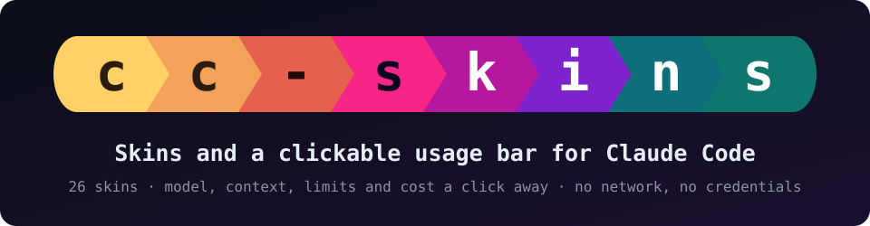</p>

<p align="center">
  <a href="https://github.com/mr-dzzs21/cc-skins/actions/workflows/ci.yml"></a>
  <a href="LICENSE"></a>
  
  
  
</p>

<p align="center"><b>Skins and a clickable usage bar for <a href="https://code.claude.com">Claude Code</a>.</b><br>
Your chat as cards, a bar that keeps model, context, limits and cost in view, one click to change what you see.</p>

<p align="center"></p>
<p align="center"><sub>A real session, recorded in nine of the 26 skins.</sub></p>

<p align="center">
  <a href="#install"><b>Install</b></a> ·
  <a href="#a-quick-tour"><b>Tour</b></a> ·
  <a href="#skins"><b>Skins</b></a> ·
  <a href="#commands"><b>Commands</b></a> ·
  <a href="#help"><b>Help</b></a> ·
  <a href="docs/README.md"><b>Docs</b></a>
</p>

## Install

**1. Get Claude Code** 2.1.296 or newer ([setup guide](https://code.claude.com/docs)). Already have it? `claude update`.

| macOS, Linux | Windows (PowerShell) |
|---|---|
| `curl -fsSL https://claude.ai/install.sh \| bash` | `irm https://claude.ai/install.ps1 \| iex` |

**2. Install cc-skins**, the same on every system. In Claude Code, type:

```
/plugin install cc-skins --marketplace mr-dzzs21/cc-skins
```

Answer `y` to add the marketplace and pick the **user** scope, so every project gets it. Or from a terminal:

```sh
claude plugin marketplace add mr-dzzs21/cc-skins
claude plugin install cc-skins@cc-skins
```

**3. Pick a skin:** type `/skin`. ↑↓ previews each skin as you land on it, Enter picks it.

**4. Optional, for the full look:** icons from a [Nerd Font](https://www.nerdfonts.com), and colors for the rest of the window.

| | Icons | Colors |
|---|---|---|
| **macOS** | `brew install --cask font-meslo-lg-nerd-font`, pick *MesloLGM Nerd Font* in your terminal | Ghostty or iTerm2 scheme from [`extras/terminal`](extras/terminal) |
| **Windows** | Works with Windows Terminal's Cascadia Code as it is (arrows, short words for icons). For icons: *CaskaydiaCove Nerd Font* from [nerdfonts.com](https://www.nerdfonts.com/font-downloads), then Windows Terminal → Settings → your profile → Appearance → Font face | |
| **Linux** | A Nerd Font from [nerdfonts.com](https://www.nerdfonts.com/font-downloads) into `~/.local/share/fonts`, `fc-cache -f`, pick it in your terminal | Ghostty scheme from [`extras/terminal`](extras/terminal) |

With a Nerd Font set, type `/skin glyphs nerd`. For Claude Code's own colors, open `/theme` and pick `cc-skins · <your skin>`.

| To | Do |
|---|---|
| Update | `claude plugin marketplace update cc-skins` and `claude plugin update cc-skins@cc-skins`, then restart Claude Code |
| Hide it for a moment | `/skin hud off` (the bar) and `/skin chat off` (the cards); `on` brings them back |
| Turn it off | `claude plugin disable cc-skins@cc-skins` (`enable` turns it back on) |
| Uninstall | `claude plugin uninstall cc-skins@cc-skins` |

## Why cc-skins

- **A bar you can click.** Model and effort, branch, context, the 5-hour and 7-day limits, cost: each block opens what it shows.
- **The whole UI, not one line.** Chat cards, the spinner's and turn line's words, a matching color theme.
- **No network, no credentials.** Every figure comes from Claude Code itself.
- **Yours to shape.** Every block on or off, extras like git status or cost per hour, your own skins from one color.

## A quick tour

Every picture here is a real Claude Code session, recorded in a terminal ([how](scripts/screens)).

<table>
<tr>
<td width="55%">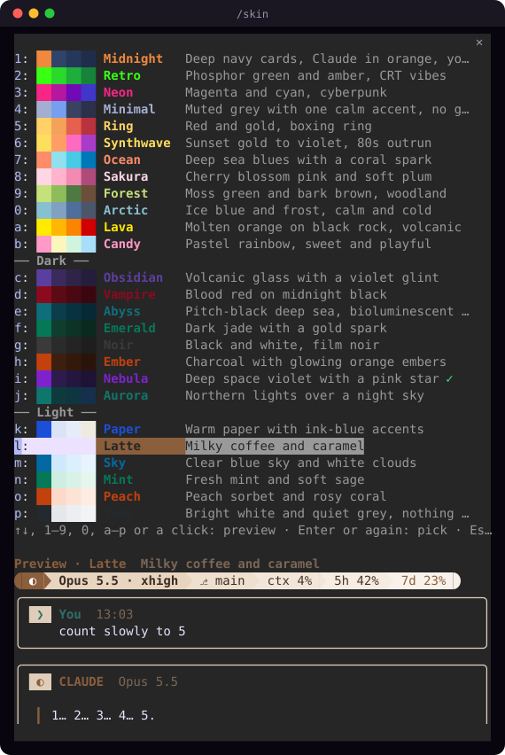</td>
<td>

### Pick a skin

`/skin`, or a click on the bar's first block. ↑↓ previews each skin as you land on it, in the picker and in the real bar; Enter picks. A skin's key or a click previews it too, and the same again picks it. Esc goes back to the one you had.

### Make your own

`/skin create` starts from any skin's words, icon and sound, takes one accent color (a swatch or any `#rrggbb`) and a style, and works out the rest, every text kept readable. `/skin export` shares it as one line of JSON.

</td>
</tr>
</table>

<table>
<tr>
<td width="50%"><b>Model and effort</b>: a click on the model<br>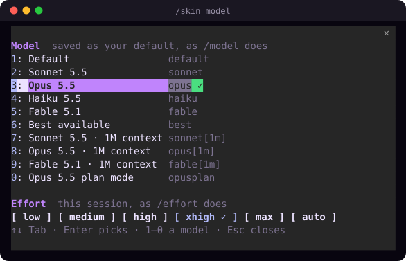</td>
<td width="50%"><b>Usage dashboard</b>: a click on the context or cost<br>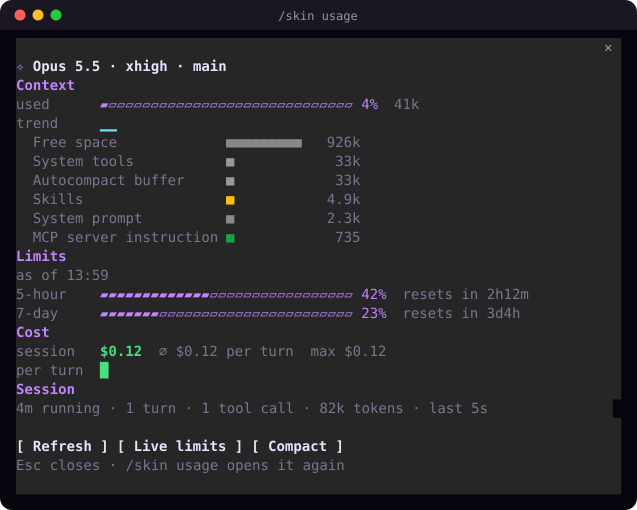</td>
</tr>
<tr>
<td width="50%"><b>Settings</b>: a click on the ⚙, each piece on or off<br>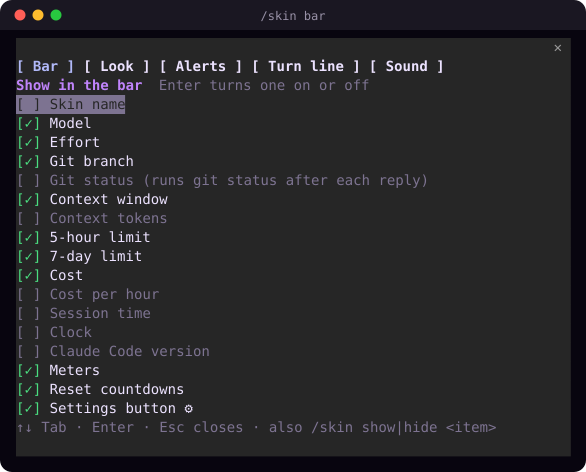</td>
<td width="50%"><b>Alerts</b>: when to warn, and in which colors<br>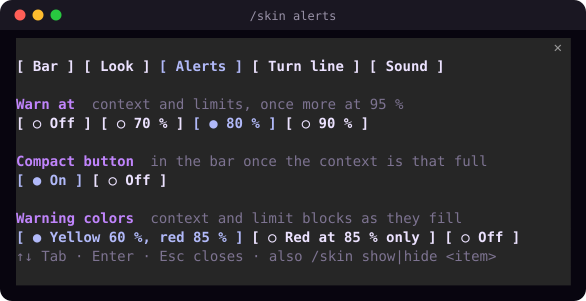</td>
</tr>
<tr>
<td width="50%"><b>Skin builder</b>: <code>/skin create</code><br>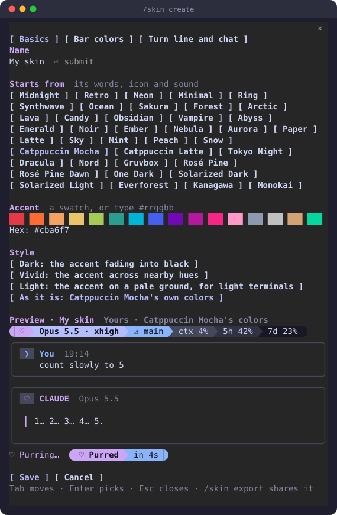</td>
<td width="50%"><b>Changed files</b>: a click on the branch<br>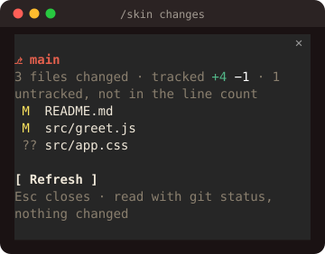</td>
</tr>
</table>

Two bar styles: colored powerline blocks, or a quiet header line (`/skin bar header`):

<p>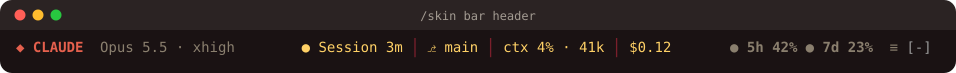</p>

As a limit or the context fills up, its block turns warning-colored at 60 % and alarm-colored at 85 % (or only at 85 %, or never):

<p>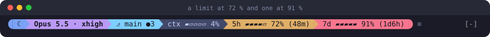</p>

And the extras, off until you turn them on: git status on the branch, context tokens, cost per hour, and session time, clock and Claude Code version:

<p>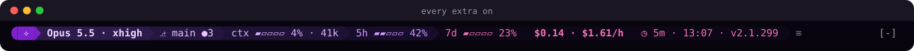</p>

More on every block, the extras and how current the limits are: [The bar](docs/bar.md).

## Skins

Twenty-six built in: twelve vivid, eight dark, six for light terminals.

<p align="center">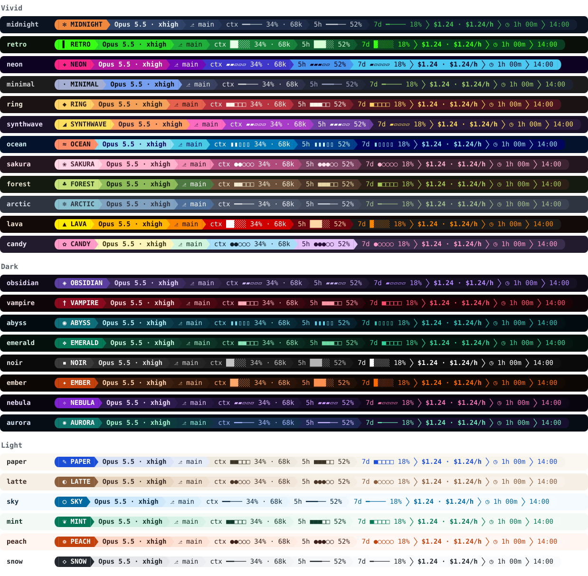</p>

Each skin's words, what a skin changes, and your own skins: [Skins](docs/skins.md).

## Commands

| Command | Does |
|---|---|
| `/skin` | Pick a skin |
| `/skin model` | Model and effort |
| `/skin bar` | Settings: what the bar shows, its look, alerts, the turn line, sound |
| `/skin usage` | Usage dashboard |
| `/skin create` | Build your own skin |
| `/skin show <item>` / `/skin hide <item>` | One piece of the bar on or off, such as `cost` or the extra `clock` |
| `/skin hud off` / `/skin hud on` | Hide or show the bar |

All of them: [Commands](docs/commands.md).

## Help

- **The bar doesn't show:** in a Claude Code that was already running, type `/reload-plugins`. Still nothing: `claude plugin enable cc-skins@cc-skins`.
- **Boxes or question marks instead of icons:** your font has no Nerd Font icons. Type `/skin glyphs powerline` (arrows only) or `/skin glyphs plain`, or set up a Nerd Font (step 4).
- **Claude Code's own colors didn't change:** `/theme` → `cc-skins · <your skin>`.

More: [Questions and fixes](docs/faq.md).

## More

[Docs](docs/README.md) · [Privacy and safety](docs/privacy.md) · [cc-skins and status line tools](docs/comparison.md) · [Development](docs/development.md) · [Contributing](CONTRIBUTING.md) · [Changelog](CHANGELOG.md)

## License

[MIT](LICENSE)
