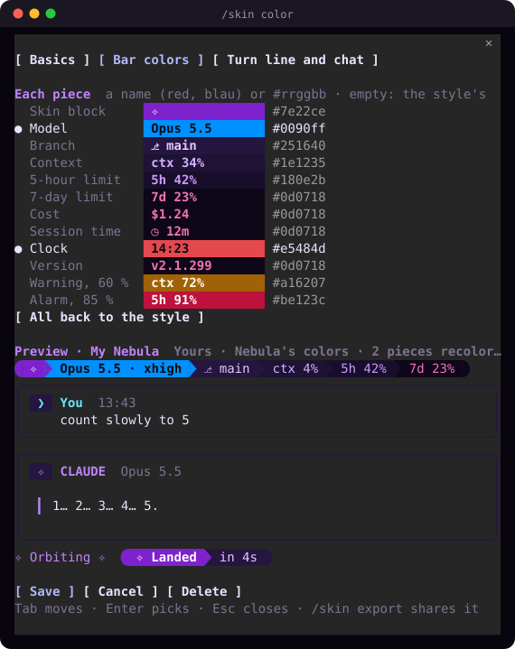

<p align="center"></p>

<p align="center">
  <a href="https://github.com/mr-dzzs21/cc-skins/actions/workflows/ci.yml"></a>
  
  
  <a href="LICENSE"></a>
</p>

<h3 align="center">See your limits. Switch models in a click. Make Claude Code yours.</h3>

<p align="center"></p>
<p align="center"><sub>A real session, in nine of the 40 skins.</sub></p>

## Install

One command, the same on macOS, Windows and Linux:

```sh
claude plugin install cc-skins --marketplace https://github.com/mr-dzzs21/cc-skins.git
```

Then open Claude Code and type **`/skin`** to pick a look. That's it. Works in the terminal, and in Claude Code inside Claude Desktop and VS Code too.

<sub>Needs Claude Code 2.1.295 or newer: `claude update` gets it. More options, updating and removing: <a href="#more-about-installing">below</a>.</sub>

## What you get

<table>
<tr>
<td width="33%" valign="top">

### 👀 See

- Your **5-hour and 7-day limits**, with when they reset
- How full the **context** is
- **Model**, **effort** and **cost**
- Your **git branch**, and what changed
- What each answer took: time, cost, tools

</td>
<td width="33%" valign="top">

### 🖱️ Control

- **Click the model** to switch model or effort
- **Click the context** for a usage dashboard
- **Compact** with one click when the context is full
- **Click the branch** for the changed files
- A **sound and a notification** when a long answer is done (if you want them)

</td>
<td width="33%" valign="top">

### 🎨 Look

- **40 skins**, with **Catppuccin, Tokyo Night, Dracula, Nord, Gruvbox, Rosé Pine** and more
- Your chat as **cards**, a spinner with its own words
- **Build your own**: every piece its own color
- **Share** a skin as one line
- Turn **any piece** on or off

</td>
</tr>
</table>

No account, no API key, no network: everything comes from Claude Code itself.

## A quick tour

<table>
<tr>
<td width="55%"></td>
<td>

### Pick a skin

`/skin`, or a click on the bar's first block. Use ↑↓ to preview each skin live, Enter to keep it.

### Make your own

`/skin create`, or straight from the prompt: `/skin color clock red`. Every text stays readable, and `/skin export` shares your skin.

</td>
</tr>
</table>

<table>
<tr>
<td width="50%"><b>Switch model and effort</b><br></td>
<td width="50%"><b>Usage dashboard</b><br></td>
</tr>
<tr>
<td width="50%"><b>Every piece its own color</b><br></td>
<td width="50%"><b>Choose what the bar shows</b><br></td>
</tr>
</table>

Warnings before you hit a limit, as blocks turn yellow and red:

<p></p>

Extras when you want more: git status, tokens, cost per hour, session time, clock:

<p></p>

## Skins

Twelve vivid, eight dark, six light, and fourteen popular themes: **Catppuccin** Mocha and Latte, **Tokyo Night**, **Dracula**, **Nord**, **Gruvbox**, **Rosé Pine** and Dawn, **One Dark**, **Solarized** Dark and Light, **Everforest**, **Kanagawa** and **Monokai**. Try one with `/skin tokyo-night`.

<p align="center"></p>

All of them with their words, and how to build your own: [Skins](docs/skins.md).

## Commands

| Type | To |
|---|---|
| `/skin` | Pick a skin |
| `/skin model` | Switch model and effort |
| `/skin usage` | Open the usage dashboard |
| `/skin bar` | Choose what the bar shows |
| `/skin create` | Build your own skin |
| `/skin color clock red` | Give one piece its own color |
| `/skin doctor` | Check that everything is right |

Or just click the bar. [All commands](docs/commands.md)

## More about installing

<details>
<summary><b>Icons and colors for the whole window</b> (optional)</summary>

| | Icons: a [Nerd Font](https://www.nerdfonts.com) | Window colors |
|---|---|---|
| **macOS** | `brew install --cask font-meslo-lg-nerd-font`, pick *MesloLGM Nerd Font* in your terminal | Ghostty or iTerm2 scheme from [`extras/terminal`](extras/terminal) |
| **Windows** | Works as it is with Windows Terminal. For icons: *CaskaydiaCove Nerd Font* from [nerdfonts.com](https://www.nerdfonts.com/font-downloads), then Settings → your profile → Appearance → Font face | |
| **Linux** | A Nerd Font from [nerdfonts.com](https://www.nerdfonts.com/font-downloads) into `~/.local/share/fonts`, then `fc-cache -f` | Ghostty scheme from [`extras/terminal`](extras/terminal) |

With a Nerd Font set, type `/skin glyphs nerd`. For Claude Code's own colors: `/theme` → `cc-skins · <your skin>`.
</details>

<details>
<summary><b>Update, pause or remove</b></summary>

| To | Run |
|---|---|
| Update | `claude plugin marketplace update cc-skins`, then `claude plugin update cc-skins@cc-skins`, and restart Claude Code |
| Hide it for a moment | `/skin hud off` and `/skin chat off` (`on` brings them back) |
| Turn it off | `claude plugin disable cc-skins@cc-skins` |
| Remove it | `claude plugin uninstall cc-skins@cc-skins` |
</details>

<details>
<summary><b>Install from inside Claude Code, or an older Claude Code</b></summary>

Inside Claude Code, the same works as a slash command: `/plugin install cc-skins --marketplace https://github.com/mr-dzzs21/cc-skins.git`.

cc-skins needs Claude Code 2.1.295 or newer, and tells you when yours is older. `claude --version` shows yours. The stable update channel can be a week or two behind: switch to latest in `/config` → Auto-update channel (with Homebrew: the `claude-code@latest` cask), or run `claude install latest`.
</details>

## Help

- **Nothing shows?** In a Claude Code that was already open, type `/reload-plugins`. In Claude Desktop, the session must run on your computer, not in the cloud.
- **Boxes or question marks instead of icons?** Type `/skin glyphs powerline`.
- **Anything else?** `/skin doctor` shows what's wrong. Still stuck? [Open an issue](https://github.com/mr-dzzs21/cc-skins/issues/new?template=bug_report.yml) with its output.

[Questions and fixes](docs/faq.md) · [All docs](docs/README.md) · [How it stays working](docs/stability.md) · [Privacy](docs/privacy.md) · [vs. status lines](docs/comparison.md) · [Contributing](CONTRIBUTING.md) · [Changelog](CHANGELOG.md)

<p align="center"><sub>MIT licensed · made for <a href="https://code.claude.com">Claude Code</a> · not affiliated with Anthropic</sub></p>
